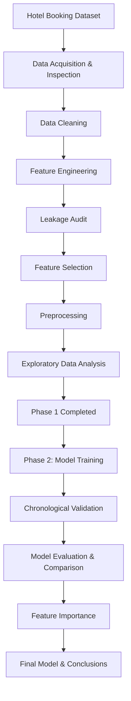

# hotel-booking-cancellation-prediction
## Predicting Booking Cancellations at Reservation Time: A Temporal Validation Study with Leakage Control on Hotel Demand Data.
### Course: Data Science Tools & Technologies
### Instructor: Dr. Asma Ahmed | TA: Burhan Hadi Butt
### Group: Nurmeen Shahid (26L-8010), Ayesha Mazher (26L-8005)

## 1. Overview
Dealing with late cancellations is one of the most frustrating parts of a business, especially for hotels because of the number of preparations and resources that goes in the preparation to welcome a guest. Thus, hotels losses significant revenue when bookings are cancelled late. In this context, this project asks;
### Can information available at reservation time help identify hotel bookings at elevated risk of cancellation, when models are trained on earlier bookings, tested on later ones, and every outcome revealing variable is excluded?
This repository currently contains Phase 1 (data acquisition, cleaning, leakage audit, feature engineering, chronological split design and exploratory analysis)
Furthermore, model training, cost analysis and evaluation will be done in phase 2.

# 2. Dataset
### source: Hotel booking demand, kaggle (https://www.kaggle.com/datasets/jessemostipak/hotel-booking-demand)
### size: 119,390 hotel bookings from 2 hotel types: City Hotels (79,330) and Resort Hotels (40,060) IN Portugal, 32 columns, arrivals from 1 july,2015 to 31 August,2017.
The data is originally from the article Hotel Booking Demand Datasets, written by Nuno Antonio, Ana Almeida, and Luis Nunes for Data in Brief, Volume 22, February 2019.
This data set contains booking information for a city hotel and a resort hotel, and includes information such as when the booking was made, length of stay, the number of adults, children, and/or babies, and the number of available parking spaces, among other things. 

# 3. How To Run
1. Open notebook in Google Collab, Jupyter Lab or Jupyter Notebook.
2. Run all cells from top to bottom in a new session.
3. The dataset is downloaded using 'kagglehub', so internet access is a necessary requirement.
4. Requirements: 'numpy', 'pandas', 'seaborn', 'matplotlib', 'scipy', 'scikit-learn', 'kagglehub' are all preinstalled in the notebook. 
5. 'RANDOM_STATE=42' is set for reproducibility

# 4. Pipeline: (Phase 1)
### Section 1, 2 and 3: 
- Download the data
- Validate the schema
- inspect distributions
- Raw data stays in df_raw.

### section 2, 3:
-2015-2016 for train/validation (78,703 rows), 2017 for test (40,687 rows).

### section 4, 5:
- fill missing values
- keep 26.8% exact duplicates
- CAP extreme ADR
- Fix categories

### section 6:
- Build 'total_nights', 'total_guests', 'is_family', 'has_agent' and others.
- Threshold comes from 2015-2016 only.

### section 7 (7.1 to 7.3):
- Classify every field by when it is known.
- Then, define feature sets A, B and C.

### section 7 (7.3):
- impute 'log1p'
- scale and one hot encoder
- fit on 2015-2016
- transform on 2017

### section 8:
- Cancellation rate with sample sizes and 95% Wilson intervals, plus 2016 vs 2017 drift

# Leakage Audit Summary
- Excluded: 'reservation_status', 'reservation_status_date', 'assigned-room-type'
- Ambiguous: 'booking_changes', 'days_in_waiting_list', 'required_car_parking_space', 'total_of_special_requests'
- Candidate, tested with and without: 'adr', 'deposit_type'
- Target: 'is_cancelled'
- Not a predictor: 'arrival_date_year'

# Key Phase 1 Findings
1. Because of class imbalance, the accuracy will be a misleading evaluation because it will always predict the dominant class in this binary classification ('not_cancelled'). Thus, PR-AUC is the primary metric.
2. City hotel cancels 41.7% and resort hotels on the other hand cancels 27.8%.
3. Cancellations rise from 9.6% (0-7 days) to 67.7% (>365 days) in both hotels of Portugal.
4. Furthermore, Groups cancel at 61.1% : The direct ones 15.3%, on the other hand Corporate ones are low at 18.7%. Lead time and segment interact strongly .
5. Moreover, non refund bookings are cancelled 99.4%  of the time, which is implausible for a refund penalty policy and suggests a recording artefacts.
6. In special requests, almost 47.7% cancellations with none and 5.0% with five.
7. Lastly, from January to August the overall rate rose from 34.7% to 38.7% with shifts in the segment mix, ADR and domestic share.

