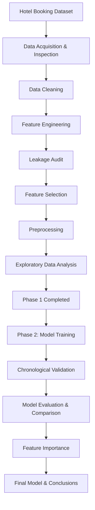

# hotel-booking-cancellation-prediction
## Predicting Booking Cancellations at Reservation Time: A Temporal Validation Study with Leakage Control on Hotel Demand Data.
### Course: DS5002: Data Science Tools & Technologies (NUCES)
### Instructor: Dr. Asma Ahmad | TA: Burhan Hadi Butt
### Group: Nurmeen Shahid (26L-8010), Ayesha Mazher (26L-8005)

## 1. Overview
Dealing with late cancellations is one of the most frustrating parts of a business, especially for hotels because of the number of preparations and resources used for a single guest. In this regard, hotels losses significant revenue when bookings are cancelled late. Therefore, this project asks;
'Can information available at reservation time actually help identify hotel bookings at elevated risk of cancellation, when models are trained on earlier bookings, tested on later ones, and every outcome revealing variable is excluded?'

Currently Phase 1 (data acquisition, cleaning, leakage audit, feature engineering, chronological split design and exploratory analysis) is completed. 
Furthermore, model training, cost analysis and evaluation will be done in phase 2.

# 2. Dataset
### source: Hotel booking demand, kaggle (https://www.kaggle.com/datasets/jessemostipak/hotel-booking-demand)
### size: 119,390 hotel bookings from 2 hotel types: City Hotels (79,330) and Resort Hotels (40,060) IN Portugal, 32 columns, arrivals from 1 july,2015 to 31 August,2017.
The data is originally from the article Hotel Booking Demand Datasets, written by Nuno Antonio, Ana Almeida, and Luis Nunes for Data in Brief, Volume 22, February 2019.
This data set contains booking information for a city hotel and a resort hotel, and includes information such as when the booking was made, length of stay, the number of adults, children, and/or babies, and the number of available parking spaces, among other things. 

# 3. Problem Definition
| Component          | Description                                                      |
|--------------------|------------------------------------------------------------------|
| Task               | Supervised Binary classification, Booking level Churn Prediction |
| Class label        | 'is_canceled' (qualitative, asymmetric binary attribute)         |
| Positive class (1) | cancelled booking, or no show                                    |
| Negative class (0) | Checked out booking                                              |
| Prediction Point   | Reservation Time                                                 |
| Main Challenge     | Preventing Data Leakage and evaluating on a later time period    |
| Phase 1 analysis   | Descriptive and Diagnostic analysis                              |
| Phase 2 analysis   | Predictive and Prescriptive analysis                             |

# 4. How To Run
1. Open notebook in Google Collab, Jupyter Lab or Jupyter Notebook.
2. Run all cells from top to bottom in a new session.
3. The dataset is downloaded using 'kagglehub', so internet access is a necessary requirement.
4. Requirements: 'numpy', 'pandas', 'seaborn', 'matplotlib', 'scipy', 'scikit-learn', are all preinstalled libraries in the notebook.
5. 'pip install kagglehub' is not installed by default only.
6. 'RANDOM_STATE=42' is set for reproducibility

# 4. Pipeline: (Phase 1)
| Step                   | Main Objective                                     | Work Performed                                |
|------------------------|----------------------------------------------------|-----------------------------------------------|
| 1. Data Acquisition    | Data Objects and attributes                        | Download, inspect dataset and retain 'df_raw' |
| 2. Chronological split | Temporal Validation                                | (2015-2016) training/validation, (2017) test  |
| 3. Data Cleaning       | Data quality, missing values, outliers, noisy data | missing values, duplicate records, outlier through IQR, check categorical consistency |  
| 4. Data Transformation | Attribute construction and discretization          | Constructing booking level attributes and group lead time in interpretable business intervals |
| 5. Attribute Selection | Attribute subset selection , redundancy, leakage audit | Retain reservation time candidates, identity ambiguous fields, exclude outcome revealing fields, and assess redundancy |
| 6. Normalization and binarization | Z score normalization and 1 hot encoding | Log transformation, impute missing values, standardize, quantitative attributes, and encode nominal attributes, fit preprocessing on 2015-2016 only |
| 7. EDA | Descriptive and Diagnostic analytics | Examine cancellation patterns, segment differences, associations, and changes over time |
| 8. Phase 2 | Predictive and Prescriptive analytics | Train and compare models, evaluate risk scores, and study cost aware intervention policies |

# Leakage Audit Summary
- Excluded: 'reservation_status', 'reservation_status_date', 'assigned-room-type'
- Ambiguous: 'booking_changes', 'days_in_waiting_list', 'required_car_parking_space', 'total_of_special_requests'
- Candidate, tested with and without: 'adr', 'deposit_type'
- Target: 'is_cancelled'
- Not a predictor: 'arrival_date_year'

# Key Phase 1 Findings
1. Because of class imbalance, the accuracy will be a misleading evaluation because it will always predict the dominant class in this binary classification ('not_cancelled'). Thus, PR-AUC is the primary metric.
2. City hotel cancels 41.7% and resort hotels on the other hand cancels 27.8%.
3. Cancellations rise from 9.6% (0-7 days) to 67.7% (>365 days) in both hotels of Portugal.
4. Furthermore, Groups cancel at 61.1% : The direct ones 15.3%, on the other hand Corporate ones are low at 18.7%. Lead time and segment interact strongly .
5. Moreover, non refund bookings are cancelled 99.4%  of the time, which is implausible for a refund penalty policy and suggests a recording artefacts.
6. In special requests, almost 47.7% cancellations with none and 5.0% with five.
7. Lastly, from January to August the overall rate rose from 34.7% to 38.7% with shifts in the segment mix, ADR and domestic share.

